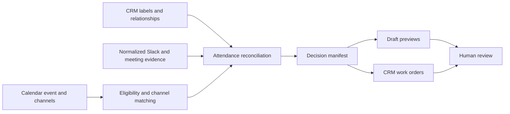

# Post-event follow-up pipeline

A working JavaScript demo that turns event attendance evidence into personalized follow-up previews and CRM work orders, with a person reviewing every action.

I built the underlying workflow to connect event operations, CRM context, and follow-up. This portfolio version adapts the decision rules from a four-stage Google Apps Script implementation into a small, testable local project. It uses fictional records and freshly written templates. The rebuild was developed with AI assistance.

## Run it

Requires Node.js 20 or newer. No dependencies, API keys, accounts, or installation are needed.

```sh
node src/demo.js
node --test
node scripts/check-public.js
```

The demo writes `demo-output/review.md` and `demo-output/manifest.json`. A checked-in review packet is available in [examples/review.md](examples/review.md).

Expected output: **8 guests, 4 draft previews, 7 CRM work orders, and a PARTIAL status**. Partial is intentional: conflicting attendance evidence, an unconfirmed walk-in, and a contact restriction require human decisions.

## The problem

A guest list does not tell you who attended. Meeting notes may arrive late, CRM labels may conflict, and the right follow-up depends on the relationship. A customer needs different copy from a new prospect. A person between roles should not receive a meeting pitch. A draft should come from someone who actually attended.

This project makes those decisions explicit and inspectable before anything reaches a customer.

## Architecture



| Stage | What it demonstrates |
| --- | --- |
| Event detection | Cancelled and tentative events, date-and-location channel matching, ambiguity, reviewer overrides |
| Reconciliation | Evidence conflicts, multiple association labels, waitlist exceptions, confirmed and unconfirmed walk-ins |
| Follow-up | Prospect, active-need, customer, and relationship variants; verified sender; attributed professional context |
| CRM work orders | Proposed attendance-label changes, association requests, decision tasks, and sourced notes |

## Example decisions

| Fictional guest | Situation | Result |
| --- | --- | --- |
| Maya | Attended; current need | Contextual follow-up with meeting ask |
| Jordan | Existing customer | Thank-you without a meeting ask |
| Sam | Between roles | Relationship follow-up without a meeting ask |
| Casey | Registered; no-show | No email; proposed non-attendee label |
| Riley | Conflicting attendance evidence | Hold for review |
| Taylor | Waitlisted without a seat | No email or label-change request |
| Morgan | Unconfirmed walk-in | Identity decision required |
| Jamie | Attended; opted out | Hold email preparation for review |

## What is implemented

- Pure orchestration and decision modules with reproducible local output.
- Calendar-status and channel-matching rules.
- Attendance normalization and relationship-aware follow-up selection.
- Template-based messages using only reviewed professional context attributed to the guest.
- A proposed LLM extraction contract that rejects unknown identities and source references.
- Stable artifact IDs, a completed-event check, and no mutation of input records.
- A Markdown review packet and JSON manifest.
- Behavioral tests and a public-file scan for common credentials and resource identifiers.

## What remains simulated

The original workflow used Calendar, Slack, HubSpot, Granola, an LLM, Gmail, and a spreadsheet registry. This demo reads JSON and writes local files. It does **not** make model calls, read live systems, create Gmail drafts, send messages, or modify CRM records.

Its extraction-contract validator demonstrates a future adapter boundary; it does not verify whether a source actually supports a model's interpretation. Context approval and host verification are explicit sample inputs. Stable IDs do not provide a durable registry or an exactly-once guarantee.

## Files

```text
src/detection.js             Calendar eligibility and channel matching
src/attendance.js            Evidence normalization and context selection
src/follow-up.js             Follow-up policy
src/extraction-contract.js   Proposed model-output boundary
src/pipeline.js              Orchestration and review rendering
src/demo.js                  Local runner
examples/event.json          Fictional event fixture
examples/review.md           Generated sample review packet
test/                       Behavioral and failure-case tests
scripts/check-public.js      Public-file scan
```

Read [design notes](docs/design.md) for the tradeoffs and [source adaptation notes](docs/source-adaptation.md) for what was retained or changed.

## Next iteration

Add source adapters and evaluate extracted evidence against human-reviewed examples. Then add a persistent registry with locking, per-stage retries, and upserts before connecting draft or CRM-task creation. Keep human review as a separate action.

## Public demo scope

All guest names, emails, venues, channels, IDs, and conversation details are fictional. Production source exports, credentials, internal documents, staff rosters, account identifiers, company-specific copy, and internal reports are excluded. No license to the original production materials is implied.
